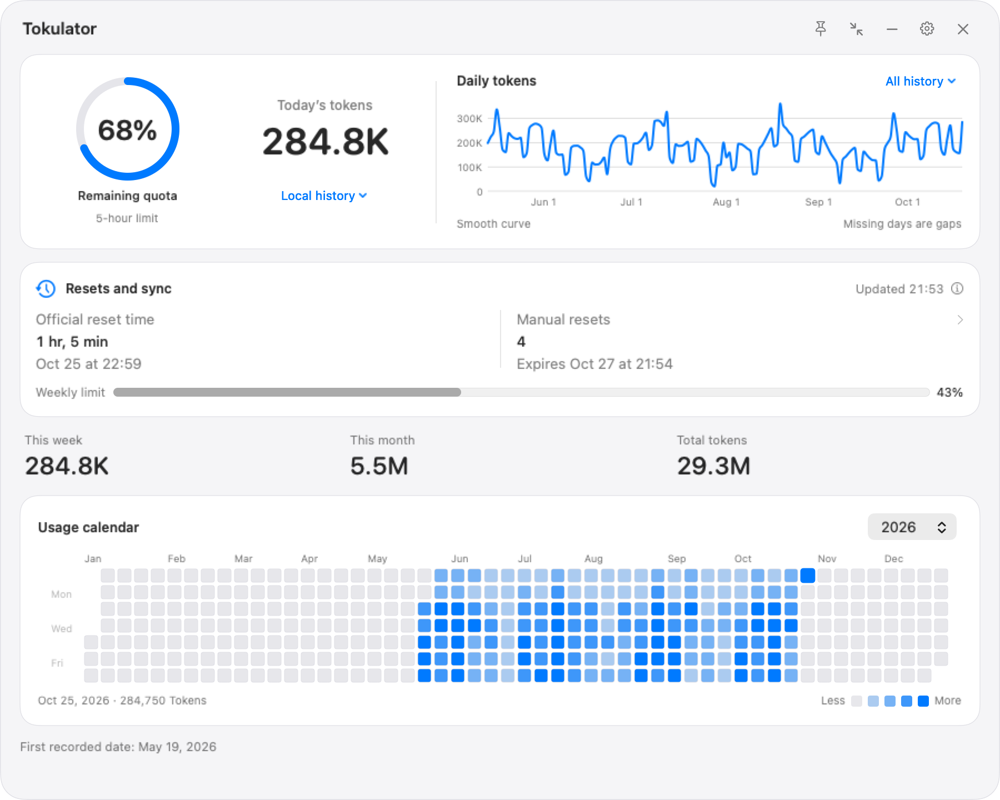
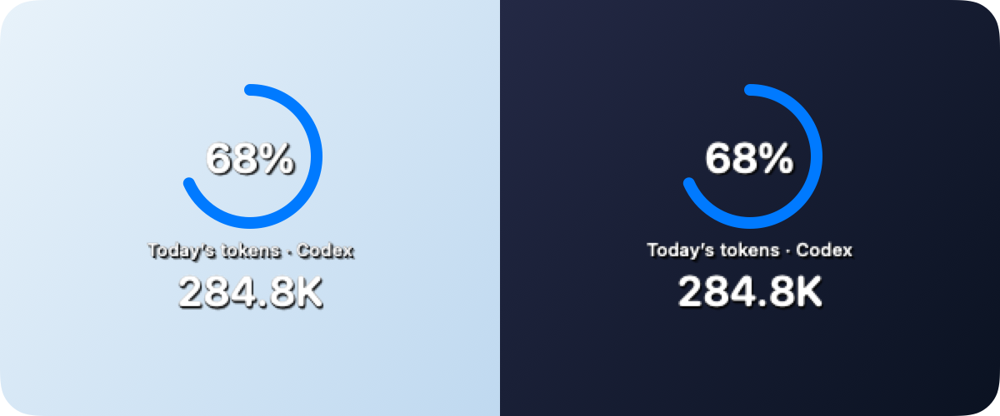
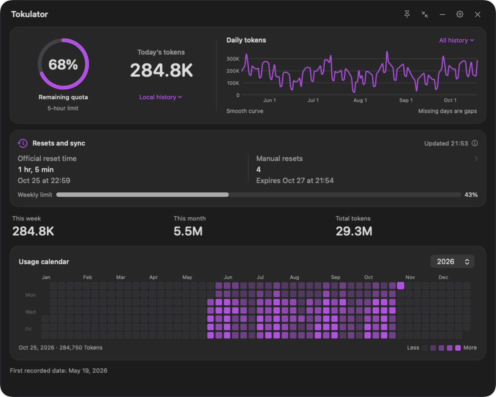
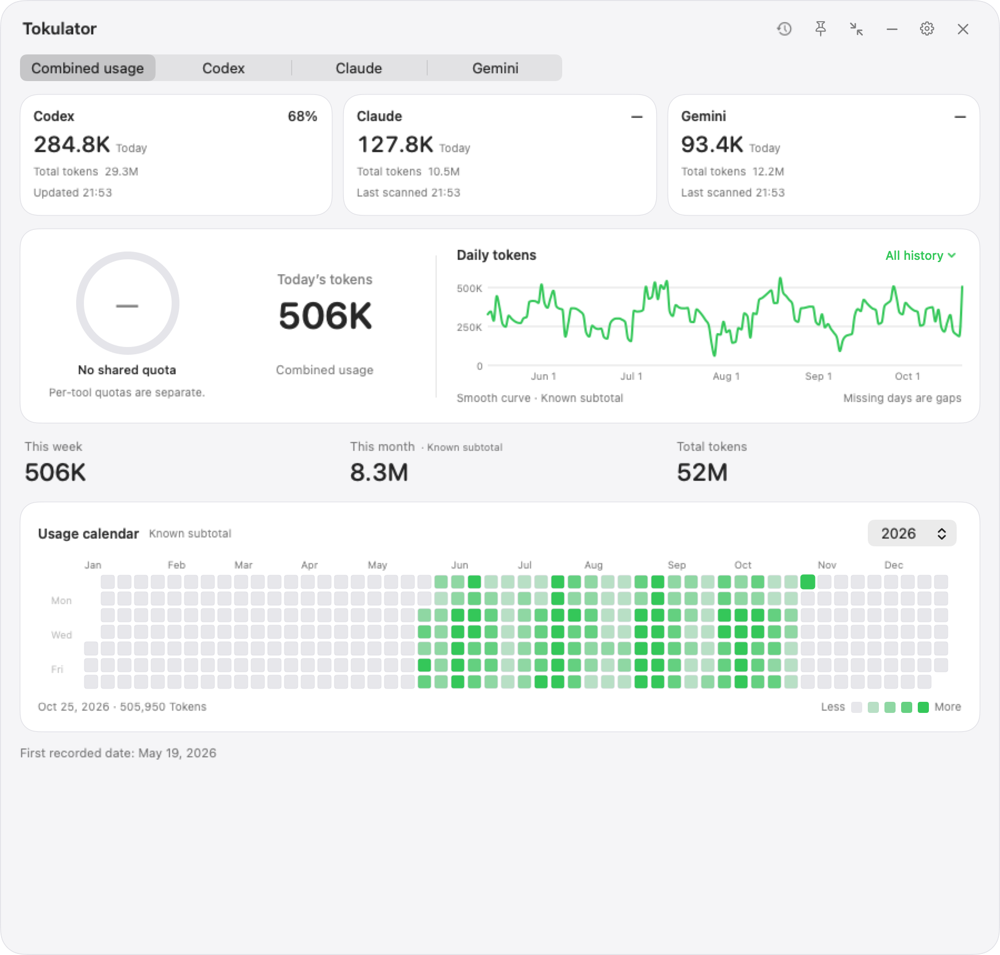

# Tokulator

### Your AI usage, at a glance.

A native Mac companion for token usage, Codex quota, and the patterns behind your work.

**[Download for Mac](https://github.com/Krystal-Chloe/Tokulator/releases/latest)** &nbsp; / &nbsp; [Release notes](https://github.com/Krystal-Chloe/Tokulator/releases/tag/v0.5.5) &nbsp; / &nbsp; [Report an issue](https://github.com/Krystal-Chloe/Tokulator/issues)

macOS 14+ &nbsp; | &nbsp; Apple silicon &nbsp; | &nbsp; Free preview v0.5.5

  

Actual Tokulator interfaces rendered with synthetic demo data. No real account history is shown.

 

| Know what is left | See the pattern | Keep it close |
| --- | --- | --- |
| Codex quota, reset times, and reset credits when reported by your account. | Exact daily values, a usage calendar, and retained totals across your selected sources. | A menu-bar summary, compact dashboard, and transparent Mini overlay. |

### A little presence. A clear view.

Mini keeps the quota ring and today's tokens above your windows and follows desktop Spaces. Restore the dashboard whenever you need more detail; your previous compact and Pin choices are preserved.

 
The same transparent Mini on two generated backgrounds. Fixed white text, a directional shadow, and no screen sampling.

### Make it yours.

Choose from nine accent colors, light or dark appearance, and 17 interface languages. Start with Codex, then add Claude Code or Gemini CLI when you want their local usage alongside it.

<table>
<tr>
<th align="left">Dark appearance</th>
<th align="left">Three sources, one overview</th>
</tr>
<tr>
<td valign="top"></td>
<td valign="top"></td>
</tr>
<tr>
<td valign="top">Choose appearance independently of your accent color.</td>
<td valign="top">Independent source totals. Codex quota stays Codex-only.</td>
</tr>
</table>

### Get started

1. Download the application ZIP from **Assets** on the [latest release](https://github.com/Krystal-Chloe/Tokulator/releases/latest).
2. Extract it and move **Tokulator.app** to **Applications**.
3. Open Tokulator. Codex is selected by default; Settings lets you add sources and choose appearance, language, or a custom usage folder.

**Requires an Apple silicon Mac running macOS 14 or later.** This preview is free to try. Future Pro features and pricing have not been announced.

**First launch:** the preview is ad-hoc signed and has **not been notarized by Apple**. If macOS blocks it and you trust the download, first try opening the app, then use **System Settings > Privacy & Security > Open Anyway**, if offered, and confirm. Follow [Apple's guidance](https://support.apple.com/en-us/102445). There is no need to disable Gatekeeper.

GitHub's automatic **Source code** downloads contain this repository's documentation, not an installable app or the private application source.

### Understand your data

- **Codex:** live account quota needs an installed, signed-in Codex and a network connection. Retained local usage can be read offline. Quota describes reported usage windows, not a literal balance of remaining tokens.
- **History and login are separate:** choosing a usage folder imports retained history; it does not change Codex's login location or select a different Codex account. Local usage can be available before quota has successfully synced.
- **Claude Code and Gemini CLI:** usage comes from retained local CLI logs. Their website, mobile, account-wide history, and official quota are not connected. The adapters do not read those tools' authentication keys.
- **Missing stays unknown:** absent or damaged records can leave gaps. Combined views label known subtotals when a source is missing or incomplete. Quota percentages are never added or averaged.
- **Daily values stay exact:** smoothing changes the curve's shape, not the recorded values. This is a usage companion, not an authoritative billing statement.

<strong>Local folders and custom locations</strong>

Tokulator finds data under the current macOS user's home directory and scans only selected sources. It does not include the developer's history or search other users' home folders.

| Source | Default usage folder | Environment override |
| --- | --- | --- |
| Codex | `~/.codex` | `CODEX_HOME` |
| Claude Code | `~/.claude/projects` | `CLAUDE_CONFIG_DIR`, then `projects` |
| Gemini CLI | `~/.gemini/tmp` | `GEMINI_CLI_HOME`, then `.gemini/tmp` |

An environment setting must reach the running app. An app opened from Finder may not inherit exports from a terminal. **Choose usage folder...** in Settings selects the actual local-history folder shown above and takes priority over automatic history discovery; you can return to the default later. This folder chooser does not move Codex authentication or change which account Codex uses for live quota.

A first launch without records stays unknown. Missing folders, access problems, and damaged records are reported. Changing folders clears the previous displayed source data before rescanning. Detecting an identifiable Codex account change clears stale official account data. Original logs are not deleted.

Local logs may include earlier cloud accounts used by the same Mac user; they are not automatically a complete history belonging only to the currently signed-in account.

<strong>Preview scope and feedback</strong>

Native macOS widget-gallery integration is not available in this preview. Mini is a separate app window, not a WidgetKit desktop widget. No Intel or Windows binary is included.

This repository contains product information, synthetic demonstration images, and application download links. **Application source is private and is not included. No open-source license has been announced.**

Please [report reproducible issues](https://github.com/Krystal-Chloe/Tokulator/issues) with the app version, macOS version, selected source, and steps to reproduce. Remove account details from screenshots and do not upload conversation logs or usage-history files.

 

Tokulator &nbsp; / &nbsp; Copyright 2026 Krystal-Chloe

